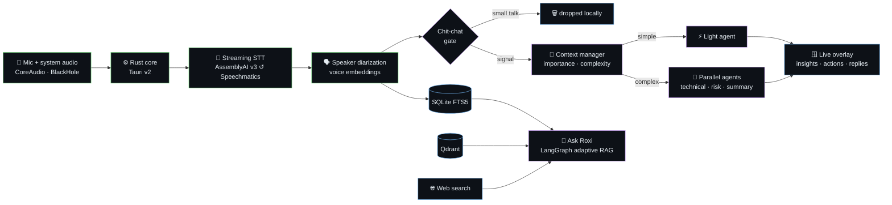
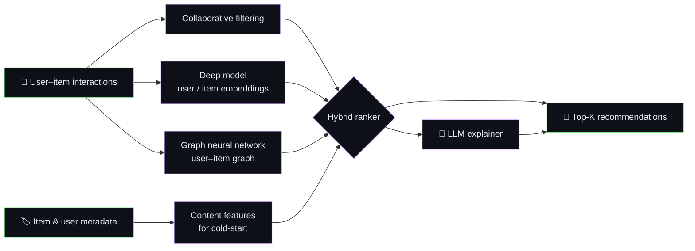

<p align="center">
  
</p>

<p align="center">
  <a href="https://git.io/typing-svg"></a>
</p>

<p align="center">
  <a href="https://manthanmittal.in"></a>
  <a href="https://www.linkedin.com/in/manthanmittal"></a>
  <a href="mailto:manthanmittal93@gmail.com"></a>
  
</p>

## 🧠 About me

> **I care about ML that survives contact with real users and real data.**

Most of my time goes to **recommendation systems**, **agentic LLM workflows**, and the unglamorous
data engineering underneath both.

```python
class Manthan:
    role      = "AI/ML Engineer"
    based_in  = "Ahmedabad, India 🇮🇳"
    education = "MSc Artificial Intelligence · University of Essex 🎓"
    focus     = ["Recommender systems", "RAG & multi-agent LLMs", "MLOps"]
    currently = "Shipping anomaly detection on live industrial sensor streams"
    learning  = ["Graph ML at scale", "Low-latency inference"]

    def philosophy(self):
        return "If it only works in the notebook, it doesn't work."
```

## 🚀 Featured work

<table>
  <tr>
    <td width="50%" valign="top">
      <h3>🎙️ <a href="https://github.com/manthan291999/Roxi-a-real-time-AI-meeting-copilot">Roxi</a> — real-time AI meeting copilot</h3>
      <p>Desktop copilot that listens to <b>both sides</b> of any Zoom / Meet / Teams call and surfaces explanations, action items, risks and suggested replies <i>while the meeting is still happening</i>.</p>
      <ul>
        <li>Rust-native <b>multi-agent pipeline</b> with a chit-chat gate and complexity routing to keep LLM cost down</li>
        <li>Streaming STT (AssemblyAI v3, Speechmatics fallback) + speaker diarization via voice embeddings</li>
        <li><b>Ask Roxi</b>: LangGraph adaptive RAG over meeting history (BM25 / FTS5), documents (Qdrant) and the web</li>
      </ul>
      
      
      
      
    </td>
    <td width="50%" valign="top">
      <h3>🎯 <a href="https://github.com/manthan291999/Recengine">Hybrid recommendation engine</a></h3>
      <p>Collaborative filtering + deep learning + <b>graph neural networks</b>, with an LLM layer that explains <i>why</i> something was recommended.</p>
      <ul>
        <li>Designed for <b>cold-start</b> users and items and sparse interaction data</li>
        <li>Multiple candidate generators blended by a single hybrid ranker</li>
        <li>Natural-language explanations grounded in the signals that drove each score</li>
      </ul>
      
      
      
    </td>
  </tr>
  <tr>
    <td width="50%" valign="top">
      <h3>📈 <a href="https://github.com/manthan291999/PredictML-Studio">PredictML Studio</a> — explainable AutoML</h3>
      <p>End-to-end ML platform for tabular data: automated model selection, global and local explainability, and GPT-4 written narratives of what the model learned.</p>
      <ul>
        <li><b>SHAP</b> and <b>LIME</b> explanations, per prediction and per model</li>
        <li>FastAPI + scikit-learn backend, React + Vite frontend</li>
      </ul>
      
      
      
    </td>
    <td width="50%" valign="top">
      <h3>🏭 Sensor anomaly detection <sub>(in production)</sub></h3>
      <p>ETL pipelines and deep learning models monitoring equipment efficiency on <b>live industrial sensor streams</b>.</p>
      <ul>
        <li>From raw, noisy sensor data to reliable features</li>
        <li>Models that flag drops in efficiency before they become downtime</li>
      </ul>
      
      
      
    </td>
  </tr>
</table>

## 🏗️ Under the hood

<details open>
<summary><b>How Roxi turns live audio into insights</b></summary>
<br>



</details>

<details>
<summary><b>How the hybrid recommender scores and explains</b></summary>
<br>



</details>

## 🛠 Toolbox

<table>
  <tr>
    <td align="right"><b>Languages</b></td>
    <td></td>
  </tr>
  <tr>
    <td align="right"><b>ML & data</b></td>
    <td>
      
      
      
      
    </td>
  </tr>
  <tr>
    <td align="right"><b>LLMs & agents</b></td>
    <td>
      
      
      
      
      
    </td>
  </tr>
  <tr>
    <td align="right"><b>Apps & APIs</b></td>
    <td></td>
  </tr>
  <tr>
    <td align="right"><b>Infra & workflow</b></td>
    <td>
      
      
      
    </td>
  </tr>
</table>

## 📊 GitHub stats

<p align="center">
  
  
</p>
<p align="center">
  
</p>

## 🤝 Let's connect

<p align="center">
  <b>Happy to talk recommender systems, applied LLM work, or anything involving messy real-world data.</b><br>
  <sub>⭐ If something here helps you, a star goes a long way.</sub>
</p>


