<p align="center">
  
</p>

<p align="center">
  <a href="https://git.io/typing-svg"></a>
</p>

<p align="center">
  <a href="https://manthanmittal.in"></a>
  <a href="https://www.linkedin.com/in/manthanmittal"></a>
  <a href="mailto:manthanmittal93@gmail.com"></a>
  
</p>

---

I care about ML that survives contact with real users and real data. Most of my time goes to
recommendation systems, agentic LLM workflows, and the unglamorous data engineering underneath both.
MSc in Artificial Intelligence from the University of Essex; currently shipping ML for industrial
sensor data in Ahmedabad.

### 🔭 What I'm building

```diff
+ Hybrid recommendation engine
  collaborative filtering + deep learning + graph neural networks, with an LLM layer
  that explains *why* something was recommended. Built for cold-start and sparse data.

+ Live meeting assistant
  Rust audio core for low-latency capture, feeding coordinated LLM agents that
  transcribe, summarise, and flag risks while the meeting is still happening.

+ Sensor anomaly detection
  ETL pipelines and deep learning models monitoring equipment efficiency in production.
```

### 🛠 Tech I work with

<p>
  
  
  
  
</p>
<p>
  
  
  
  
  
</p>
<p>
  
  
  
  
</p>

### 📊 Stats

<p align="center">
  
  
</p>

<p align="center">
  <picture>
    <source media="(prefers-color-scheme: dark)" srcset="https://raw.githubusercontent.com/manthan291999/manthan291999/output/snake-dark.svg">
    
  </picture>
</p>

---

<p align="center">
  <sub>Happy to talk recommender systems, applied LLM work, or anything involving messy real-world data.</sub>
</p>
